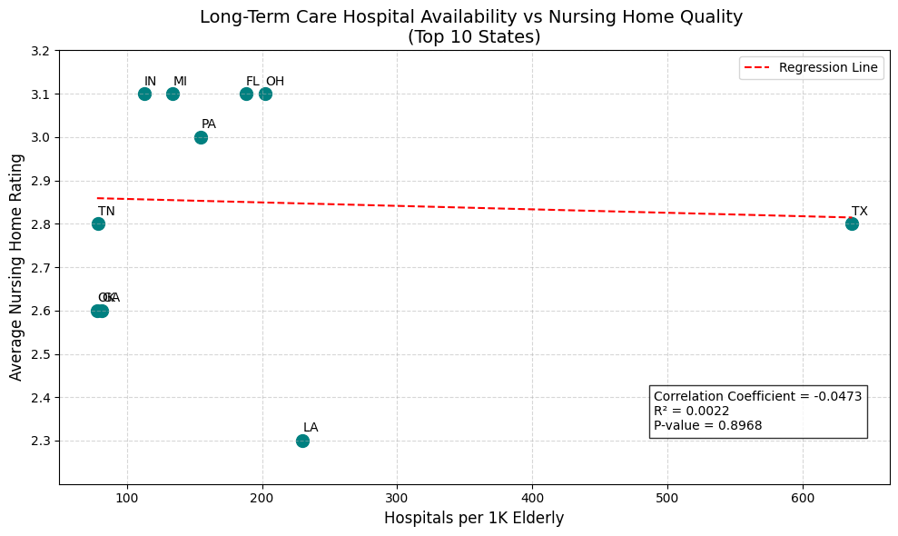
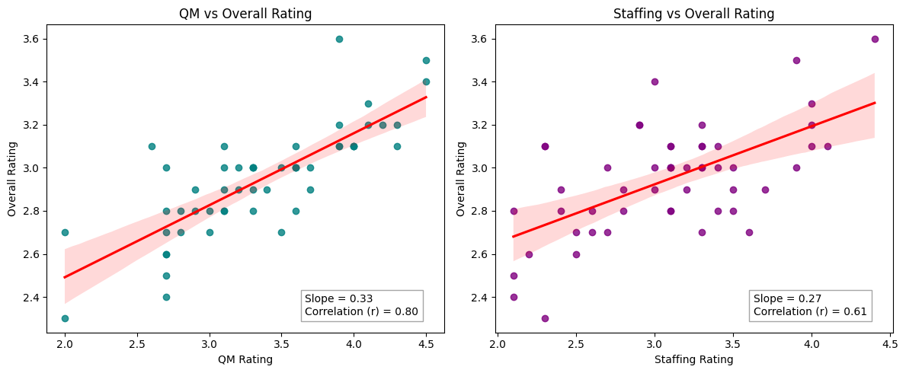

# U.S. Healthcare Access and Quality for Older Adults

**Population health | Data integration | Statistical analysis | Python**

## Research question

**Why it matters:** As the population ages, policymakers and providers need to decide whether to expand healthcare capacity or improve existing services.

**Business question:** Which states and regions show gaps in healthcare availability, nursing home quality and older adults' health, and which indicators could guide resource allocation?

## Data and approach

Academic team project combining CDC Healthy Aging/BRFSS data (284,142 source rows, 2015–2022), a U.S. hospital directory (7,570 records) and CMS state-level nursing home ratings (54 source rows). Standardized geographic codes, retained missing measures rather than replacing them with zero, compared state/region indicators and examined rating relationships using correlation and OLS regression.

## Key findings

- Among the ten states compared, long-term care availability and nursing home quality showed almost no linear association (r = −0.0473, R² = 0.0022).
- Older adults in the three highest-rated states reported good-to-excellent health at 76.5–81.7%, compared with 69.7–77.7% in the three lowest-rated states.
- The OLS model relating quality measure and staffing ratings to overall rating reported R² = 0.909; quality measure ratings had the stronger association.

## Business implications and limitations

Capacity and care quality should be assessed separately when prioritizing investments. State-level associations are not causal or individual-level evidence. The notebook's accessibility denominator relies on survey-related counts, not independently verified census population totals. Overall ratings incorporate component ratings, so the regression is descriptive rather than independent validation.

## Explore the analysis

[Project notebook](notebooks/state-healthcare-access.ipynb)

Sources: [CDC](https://data.cdc.gov/Healthy-Aging/Alzheimer-s-Disease-and-Healthy-Aging-Data/hfr9-rurv/about_data), [hospital directory](https://www.kaggle.com/datasets/carlosaguayo/usa-hospitals), [CMS](https://data.cms.gov/provider-data/dataset/xcdc-v8bm).
